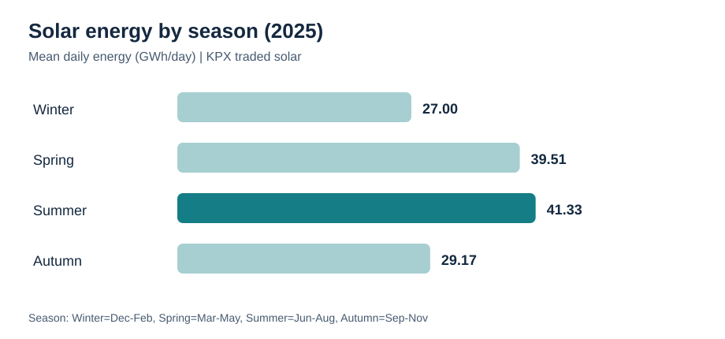
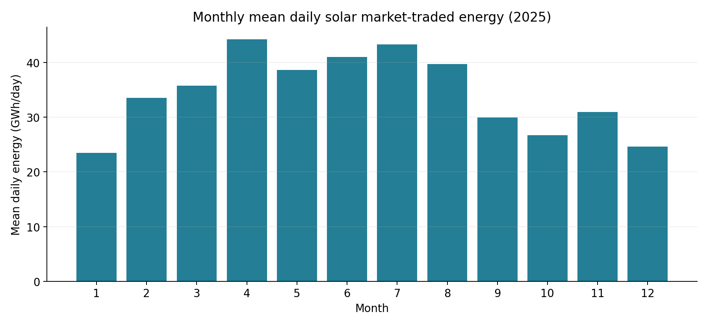
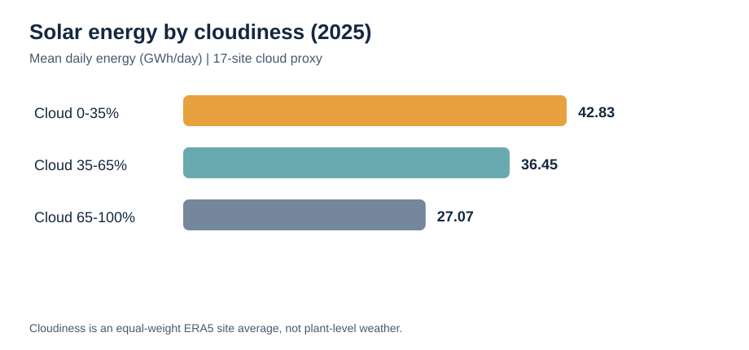
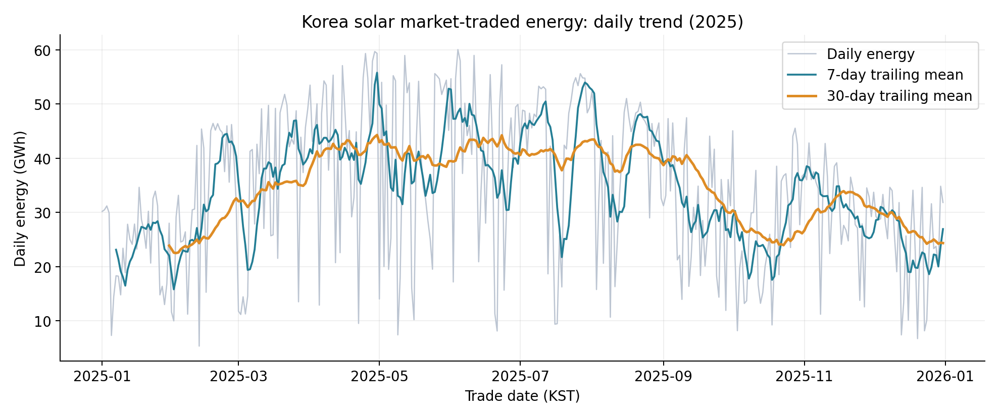
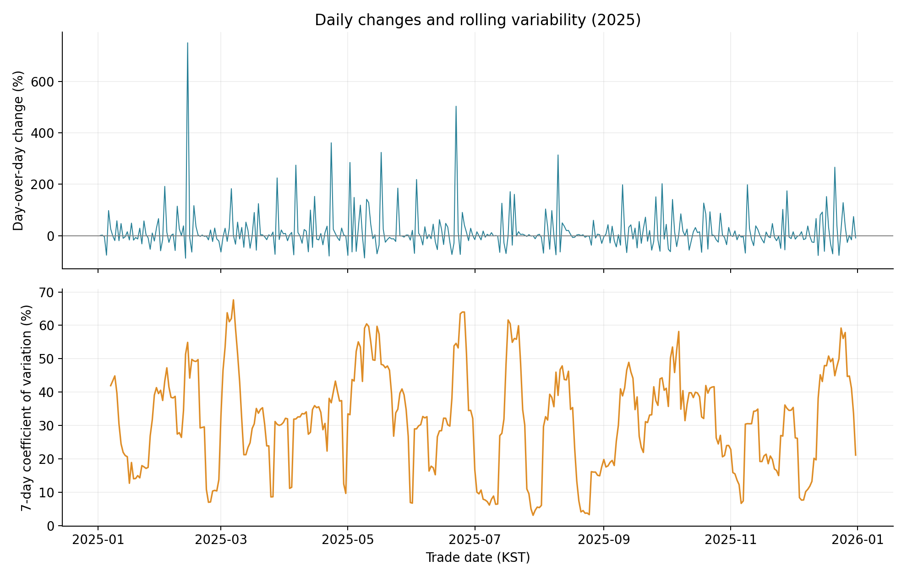

# 한국 태양광 발전량은 언제, 어떤 날씨에서 가장 많은가?
## 2025년 계절별·월별·구름량별 시계열 분석

> **분석 대상:** 한국 전체 태양광 발전량이 아닌 **KPX 전력시장 참여 태양광 설비의 전력거래량(ESS 충·방전 포함)**입니다. 기상은 실제 발전소별 관측값이 아니라 **17개 지역 대표 지점의 ERA5 재분석자료를 동일 가중치로 평균한 지표**입니다.

## 1. 분석 주제 및 선정 이유
태양광 발전량이 단순히 여름에 가장 많을지, 월별로 어떤 차이가 있는지, 구름이 많은 날에는 얼마나 적은지를 실제 2025년 자료로 확인합니다. 평균뿐 아니라 하루 사이 급격한 변화가 있었는지도 살펴 전력 수급 계획에 주는 의미를 정리합니다.

## 2. 분석 질문
1. **계절별:** 봄·여름·가을·겨울 중 평균 일발전량이 가장 높은 계절은 언제인가?
2. **월별:** 1~12월 중 최고·최저 월은 언제이며 차이는 얼마나 나는가?
3. **날씨별:** 전국 대표 지점의 평균 구름량이 적은 날과 많은 날의 발전량은 얼마나 다른가?
4. **안정성:** 하루 사이 발전량이 급감한 사례는 언제였는가?

## 3. 데이터 설명
- **발전량 출처:** 한국전력거래소(KPX), [공공데이터포털 원본 페이지](https://www.data.go.kr/data/15065269/fileData.do), 자료명: 한국전력거래소_지역별 시간별 태양광 및 풍력 발전량_20251231. 2026-10-03 수집.
- **기상 출처:** [Open-Meteo Historical Weather API](https://open-meteo.com/en/docs/historical-weather-api)의 **ERA5** 재분석자료(구름량·강수량·일조시간). 서울·부산·대구·인천·광주·대전·울산·세종 및 경기·강원·충북·충남·전북·전남·경북·경남·제주의 각 대표 지점, 총 17개. 위치와 재수집 방법은 README에 기록했습니다. Open-Meteo 데이터 출처 표기 필요.
- **기간:** 2025-01-01~2025-12-31, 대한민국 일자 기준.
- **관측값:** 발전량 원본 166,440행 중 태양광 148,920행, 17지역 × 24시간 × 365일을 합산한 **일별 365개**, 기상도 일별 365개.
- **주요 열:** 거래일, 거래시간, 지역, 연료원, 전력거래량(MWh). 결합 기상 열은 날짜, 평균 구름량(%), 평균 강수량(mm), 평균 일조시간(시간), 구름량 그룹입니다. 1GWh=1,000MWh.
- **정제:** 날짜를 파싱하고 일자·시간·지역 중복 0개, 원본 결측 0개, 기대하는 지역×시간 조합 누락 0개, 음수 0개를 확인했습니다. 기상 365일도 날짜 중복·누락을 확인해 발전량 날짜와 결합했습니다. 결측값을 임의로 삭제하거나 보간하지 않았습니다.
- **이상치:** 발전량 일별 IQR×1.5 기준 범위 −9,178.93~78,600.87 MWh에서 후보 0개. 값이 극단적이라는 이유만으로 발전량을 삭제하지 않았습니다.
- **주의:** 날짜를 맞춘 것은 전국 총량과 기상 대표 지점 평균의 비교일 뿐, 각 발전소 위치의 실제 일조 조건이나 인과관계를 측정한 것은 아닙니다.

## 4. 분석 방법
1. **월별 평균:** 해당 월의 1일 평균 발전량을 구해 28~31일이라는 월 길이 차이를 보정했습니다.
2. **계절별 평균:** 봄=3~5월, 여름=6~8월, 가을=9~11월, 겨울=12·1·2월로 정의하고 각 계절의 일별 평균을 비교했습니다.
3. **구름량별 비교:** 전국 17개 대표 지점의 일평균 구름량을 지역별 발전설비 규모와 무관하게 **동일 가중치로 평균**했습니다. 평균 구름량 **35% 이하(적음), 35% 초과~65% 미만(중간), 65% 이상(많음)**으로 분류했습니다. 이는 분석용 구분 기준이지 기상청의 공식 맑음/흐림 예보 분류가 아닙니다.
4. **보조 검증:** 각 계절 안에서도 구름량이 적은 날과 많은 날을 비교하고, 지역 평균 강수량 1mm 이상인 날도 별도로 비교했습니다. 구름량과 발전량의 피어슨 상관계수를 계산했습니다.
5. **시계열 기법:** 7일·30일 이동평균, 일별 변화율, 최근 7일 변동계수(CV)로 단기 급변을 확인했습니다.

## 5. 분석 결과 및 시각화

### 5.1. 계절별 발전량 — 여름이 가장 높았습니다

| 계절 | 일수 | 평균 일발전량 |
|---|---:|---:|
| 봄(3~5월) | 92일 | 39.512 GWh |
| **여름(6~8월)** | **92일** | **41.334 GWh** |
| 가을(9~11월) | 91일 | 29.169 GWh |
| 겨울(12~2월) | 90일 | 27.001 GWh |

여름의 평균 일발전량은 겨울보다 **약 53.1% 높았습니다**. 단, 한 해만 분석했으므로 이것을 모든 해에 반복되는 확정적 계절성으로 일반화하지는 않습니다.

### 5.2. 월별 발전량 — 4월이 최고, 1월이 최저였습니다

**4월 44.272GWh/일**로 최고, **1월 23.476GWh/일**로 최저였습니다. 4월은 1월보다 **약 88.6% 높습니다**. 7월도 43.298GWh/일로 높았지만, 연중 최고인 달은 4월이었습니다. 따라서 **여름이 평균적으로 가장 높은 계절인 것**과 **4월이 가장 높은 단일 월인 것**은 모순되지 않습니다.

### 5.3. 구름량별 발전량 — 구름이 적은 날의 평균이 높았습니다

| 전국 17지점 평균 구름량 | 날짜 수 | 평균 일발전량 |
|---|---:|---:|
| **35% 이하(적음)** | 92일 | **42.827 GWh** |
| 35% 초과~65% 미만(중간) | 127일 | 36.451 GWh |
| **65% 이상(많음)** | 146일 | **27.075 GWh** |

구름량이 적은 날의 평균 발전량이 많은 날보다 **약 58.2% 높았습니다**. 일별 구름량과 발전량의 상관계수는 **−0.544**로 음의 관계를 보였습니다. **겨울·봄·여름·가을 각각에서도** 구름이 적은 날의 평균 발전량이 많은 날보다 높았습니다.

추가로 17지점 평균 강수량이 **1mm 이상**인 126일의 평균 발전량은 **24.718GWh/일**, 그 미만인 239일은 **39.363GWh/일**이었습니다. 강수량 기준 역시 17지점의 평균값이므로 전국 모든 지역이 비가 왔다는 뜻은 아닙니다.

### 5.4. 일별 급변 및 이동평균

2025년 **2월 12일**은 전날 42.352GWh에서 5.340GWh로 **87.39% 감소**했습니다. 7일 변동계수 최고는 **3월 7일에 끝나는 구간의 67.63%**였습니다. 급감이 관찰되었다고 해서 해당일의 원인이 특정 기상현상이었다고 단정할 수는 없습니다.

## 6. 인사이트

### 인사이트 1 — '태양광은 언제 가장 많이 생산되는가?'
- **관찰(Fact):** 2025년 계절 평균은 **여름 41.334GWh/일**이 최고였고 겨울 27.001GWh/일이 최저였습니다(계절 그래프).
- **해석(Hypothesis):** 계절에 따라 일조 조건이 달라지는 영향이 있을 수 있습니다. 그러나 설비 용량이나 전력시장 참여 변화도 영향을 줄 수 있습니다.
- **의미(Implication):** 태양광 발전량의 연중 활용 계획을 세울 때 **계절마다 같은 평균을 적용하는 것은 적절하지 않습니다**.

### 인사이트 2 — '여름 중 특정 달이 무조건 최고는 아니다'
- **관찰(Fact):** **4월 44.272GWh/일**, **1월 23.476GWh/일**로 4월이 약 **88.6% 높았습니다**(월별 그래프). 여름 중 7월은 43.298GWh/일입니다.
- **해석(Hypothesis):** 발전량은 계절만으로 결정되지 않으며, 월별 기상 및 일조·운영 여건이 함께 반영될 수 있습니다.
- **의미(Implication):** 월별 발전계획에서는 막연히 '여름에 가장 많다'고 정하기보다 **실제 최고·최저 월을 확인해야 합니다**.

### 인사이트 3 — '구름량은 발전량 차이를 설명하는 중요한 단서'
- **관찰(Fact):** 구름량이 적은 날 42.827GWh/일, 많은 날 27.075GWh/일로 **약 58.2% 차이**가 났습니다(구름량 그래프). 계절별로 나누어도 방향이 같았습니다.
- **해석(Hypothesis):** 구름에 따른 지표면 일사량 차이가 관련되었을 가능성이 큽니다. 다만 이 결과만으로 날씨가 발전량 차이의 **58.2%를 유발했다**고 해석할 수는 없습니다.
- **의미(Implication):** 발전량을 이해하거나 예측할 때 **달력 정보뿐 아니라 구름량·강수량 같은 기상 변수도 함께 보는 것이 유용합니다**.

### 인사이트 4 — '평균이 높아도 일별 발전량은 크게 변할 수 있다'
- **관찰(Fact):** 2월 12일 전일 대비 87.39% 감소, 최고 7일 CV 67.63%를 확인했습니다(추세·변동성 그래프).
- **해석(Hypothesis):** 날씨 외 출력제어·ESS 운영·시장 거래 조건도 관련될 수 있습니다.
- **의미(Implication):** 전력 수급이나 에너지 저장을 검토할 때 **월평균뿐 아니라 하루 단위 급변을 고려해야 합니다**.

## 7. 결론
**2025년 KPX 전력시장 참여 태양광의 일평균 거래량은 계절별로는 여름, 월별로는 4월에 가장 높았습니다.** 전국 대표 지점의 평균 구름량이 적은 날은 많은 날보다 발전량이 약 58% 높아, **월별·계절별 차이와 함께 날씨 정보를 살펴볼 실질적 이유**를 확인했습니다. 단기간 급감도 관찰되어 평균값 하나만으로 태양광 발전량을 설명하기는 어렵습니다.

## 8. 한계점
- 2025년 **1개 연도**만 분석했으므로 여러 해에 걸친 반복적인 계절성이나 장기 추세를 확정할 수 없습니다.
- 발전량은 **KPX 전력시장 거래량**으로 전국 전체 태양광 생산량이 아니며, ESS 충·방전 및 시장·운영 조건의 영향을 받습니다.
- **ERA5 17개 대표 지점의 동일 가중 평균**은 전국 모든 발전소의 실제 기상·설비 분포를 대표하지 않습니다. 지역별 설비용량 가중이나 발전소별 일사량 결합은 수행하지 않았습니다.
- 구름량 그룹 경계(35%, 65%)와 강수량 1mm 기준은 **탐색적 분석 기준**입니다. 그룹 간 차이나 음의 상관관계는 **인과관계의 증명**이 아닙니다.
- 연도 중 설비 증설 여부, 출력제어, 발전소별 설치각·방향 등을 반영하거나 설비용량으로 정규화하지 않았습니다. 구름량·일조시간 재분석값에도 모델 오차가 있습니다.

## 9. AI 사용 로그
- **AI를 사용한 작업:** 기존 코드·리포트 검토, 기상자료 수집·날짜 결합, 계절/월/구름량별 계산, 새로운 SVG 그래프·보조 코드 및 결론 작성.
- **AI 사용 이유:** 직접 코딩을 최소화하면서 질문 중심으로 분석을 개선하고 재현 가능한 계산 결과를 확보하기 위해서입니다.
- **실제 검증:** 원래 KPX CSV 검사는 기존 분석 기록에 남아 있습니다. 이번 추가 분석에서는 저장된 일별 발전량 **365개와 ERA5 기상 날짜 365개를 대조**, 그룹별 관측 일수 합계(365일), 평균, 계절 내부 비교 및 상관계수를 별도 계산했습니다. 새로운 그래프와 요약 CSV는 GitHub에 저장했습니다.
- **아직 확인할 사항:** 변경된 Python 분석 코드의 완전한 재실행과 `verify.py`의 최신 재현성 테스트는 별도로 수행해야 합니다. 테스트 전에 실행 성공을 주장하지 않습니다.
